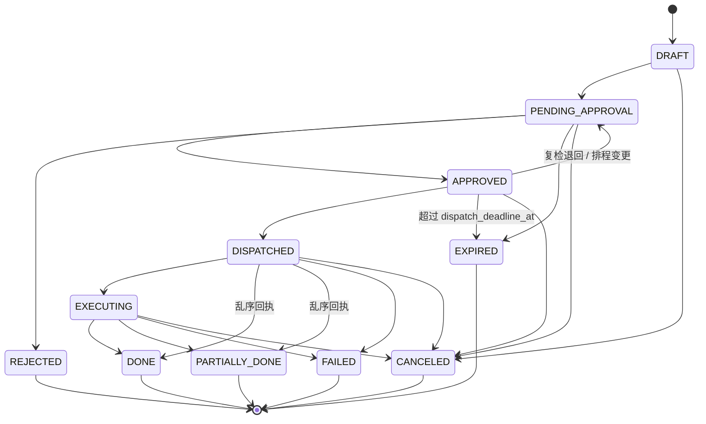

# 核心契约（P0 L1 冻结）

本文件与 `contracts/*.schema.json`、`internal/model` 一起构成 L1 冻结的契约。各阶段只引用、不修改。

## 冻结规则

- 冻结后任何变更（字段、枚举、状态、迁移边）都要升版本号，并经契约 Owner 书面批准后再合入。
- 只做向后兼容的增量：新增可选字段或新增枚举值时升 minor；删除、改名、改语义时升 major，并同时提供迁移说明。
- `internal/model` 是 Go 侧唯一实现，只能 import 标准库（archtest 守卫）。`contracts/*.schema.json` 与 `internal/model` 的一致性由 `internal/model` 下的 schema 测试校验。
- 表结构以 `migrations/0001_init.up.sql` 为准。改表只能新增迁移文件，禁止 AutoMigrate，也不能改已发布的迁移。

## 契约清单

| 契约 | Schema | Go 类型 |
|------|--------|---------|
| 建议卡 | `contracts/advice_card.schema.json` | `model.AdviceCard` |
| 引用 | `contracts/citation.schema.json` | `model.Citation` |
| 作业单 | `contracts/work_order.schema.json` | `model.WorkOrder` |
| 审批单 | `contracts/approval_ticket.schema.json` | `model.ApprovalTicket` |
| 运行状态 | `contracts/run_state.schema.json` | `model.RunState` |

## 作业单状态机

## 迁移表

与 `model.WorkOrderTransitions` 逐条一致。不在表中作为 from 出现的状态都是终态。

| from | 允许的 to |
|------|-----------|
| DRAFT | PENDING_APPROVAL, CANCELED |
| PENDING_APPROVAL | APPROVED, REJECTED, EXPIRED, CANCELED |
| APPROVED | DISPATCHED, PENDING_APPROVAL, EXPIRED, CANCELED |
| DISPATCHED | EXECUTING, DONE, PARTIALLY_DONE, FAILED, CANCELED |
| EXECUTING | DONE, PARTIALLY_DONE, FAILED, CANCELED |
| DONE / PARTIALLY_DONE / REJECTED / EXPIRED / FAILED / CANCELED | 终态，无出边 |

## 迁移执行（service.WorkOrderService.Transition）

在调用方事务（`*repository.DB`，即 `*gorm.DB`）内依次执行以下步骤，任一步失败则整个事务回滚：

1. `GetState` 读取 status、row_ver、run_id，查询带 tenant_id 和 farm_id 条件。
2. `model.CanTransition(from, to)` 判断迁移是否合法，非法返回 `model.ErrIllegalTransition`。
3. 执行乐观锁 `UPDATE work_order SET status=?, row_ver=row_ver+1, updated_at=? WHERE id=? AND tenant_id=? AND farm_id=? AND status=? AND row_ver=?`。影响 0 行时返回 `model.ErrConcurrentUpdate`。
4. 追加一行 `work_order_transition`。
5. 调用 `EventStore.AppendTx` 写入 `ORDER_TRANSITION` 事件。seq 由同一连接上的 `LAST_INSERT_ID(event_seq + 1)` 分配。

本方法不加 Redis 锁。`lock:order:{order_id}` 由需要串行化外部副作用的调用方（如 L8 下发）持有。

## 开票前约束拦截留痕（P1-L3，偏离 §6.4）

§6.4 原文要求 `constraint_check` 用 INSERT IGNORE、历次校验都可见。实现为了不加迁移，做了如下偏离：

- **PRE_APPROVAL 行为最近一次复核结果，历次拦截证据见 CONSTRAINT_BLOCKED payload。** `constraint_check(order, PRE_APPROVAL, attempt=ticket_seq)` 按 uk_check upsert，并删掉本次未出现的 rule_id。
- `CONSTRAINT_BLOCKED`（run_event，只追加；审计投影 APPROVAL / FAILED，target `order:{order_id}`）的 payload 为 `model.ConstraintBlockedPayload`：
  - `order_id`、`rule_ids`（未通过的 rule_id，按校验顺序）；
  - `checks[]`：每条未通过行的 `rule_id`、`observed`、`threshold`（原样取自校验行，`threshold.kb` 为 `kb:<kb_id>@<version>`）、`note`（即 `observed.note`）；通过行不写入；
  - `truncated`：payload 上限 8KB（8192 字节）。超出时先从 `checks` 末尾逐行截掉，仍超再截 `rule_ids` 末尾，并置 `truncated: true`；未截断时不出现该字段。
- 开票与拦截事务的第一条语句都是 `SELECT id FROM work_order WHERE tenant_id=? AND farm_id=? AND id=? FOR UPDATE`，同一张单的写入串行。拦截输给并发开票时回滚本次校验行与事件，在事务外记一条 Warn 日志（order_id、run_id、rule_ids、ticket_id）。

## 设备回执 webhook（P1-L4-B）

- 路由：`POST /api/v1/farms/:farm_id/orders/:order_id/receipts`，挂在根路由，不经用户鉴权。只在配置了 `AS_DEVICE_RECEIPT_SECRET` 时挂载，未配置启动时记 Warn。
- 签名：头 `X-Timestamp`（unix 秒）与 `X-Signature` = hex(HMAC-SHA256(secret, timestamp + "." + body))，用 `hmac.Equal` 比较，时间窗 5 分钟。
- body（JSON）：`receipt_id`、`device_type`、`device_job_id`、`status`、`failure_kind`、`done_area_mu`、`device_ts`、`code`。`receipt_id` 为空时由 `service.ReceiptIDOf` 从来源、job、状态、failure_kind、面积与 device_ts 推导。
- 反查：按 (device_type, device_job_id) 经 SystemScope 找尝试，再核对路径里的 farm_id / order_id。
- 响应：200 已处理（含重放、STALE / LATE / CONFLICT，只入库不推进）；202 反查不到（记 RECEIPT_UNMATCHED 审计）；400 body 不合法；401 签名错误或过期；403 跨农场；503 + `Retry-After: 5` 表示作业单忙或并发冲突，平台应重投。
- 回执入库（`device_receipt` INSERT IGNORE，uk_receipt 冲突即重放）、`dispatch_attempt` 更新与 `Transition` 在同一事务内完成。超时扫描只把尝试置 NO_RECEIPT 进待对账，不转 FAILED、不重发。
- 人工操作：`POST /api/v1/farms/:farm_id/orders/:order_id/cancel`（`order.cancel`）、`POST /api/v1/farms/:farm_id/orders/:order_id/reconcile`（`order.reconcile`）、`GET /api/v1/farms/:farm_id/reconcile/pending`（复用 `advice.read`）。

## 分层规则（internal/archtest，随 make test 执行）

- agent 不得 import controller、service。agent/harness 不得 import graph、knowledge、calc、guardrail、service、controller、repository。
- 生产代码（除 internal/evalkit 与 cmd/eval 外）不得 import evalkit。
- model 只能 import 标准库。controller 在模块内只能 import service 和 model。
- gorm 只允许 repository、app、cmd import。viper 只允许 config import。gin 只允许 controller import。
- `time.Now` 只允许出现在 `internal/clock/system.go`，其他代码一律通过注入的 `clock.Clock` 取时间。
- 设备 Adapter（internal/adapter）只允许下发器 `internal/service/workorder_dispatch.go` import；app、cmd 装配与 evalkit 注入 RecordingAdapter 除外（L8）。
- `repository.NewSystemScope`（跨农场扫描凭证）只允许 `internal/service/scan.go`、`internal/service/outbox.go` 调用；P1-L4 扫描迁到 `cmd/worker` 后白名单收紧为只含 `cmd/worker`（P1-L1-B）。
- 设备 Adapter（internal/adapter 及子包）不得 import repository、agent：Adapter 只翻译协议，原始指令 / 回执经 `Traced` 注入的 `RawPutter` / `CallRecorder` 接口落库，下发台账由下发器写（P1-L2）。
- `internal/agent/guardrail/constraint`（约束校验器）不得 import repository、service、agent/tools、adapter，也不得 import `os`、`net`、`database/sql`、`io/fs`：校验器只读入参观测，取数由 graph / service 完成（P1-L3）。

## P1-L4-A 接缝

- 订单锁：`service.WithOrderLock(ctx, locks KeyLocker, keys rediskey.Keys, log *slog.Logger, orderID uint64, fn func(ctx context.Context) error) error`。锁已被持有时返回 `ErrOrderBusy`，poller 延后 5 s 且不计 attempt。持锁期间每 ttl/3 用 Lua 校验 token 续期，续期失败时以 `ErrOrderLockLost` 取消 fn 的 ctx。L4-B 的中止 / 对账须走同一把锁。
- outbox handler 表：`(*App).OutboxHandlers()` 汇总 order.dispatch、notify.send 与 `OrderOpsHandlers`；`app.MergeOutboxHandlers(tables...)` 遇重复 topic 或 nil handler 报错，启动即失败。`(*App).NewOutboxPoller()` 供 cmd/worker 与 eval 共用。
- eval 排空：`evalkit.DrainOutbox(ctx, a *app.App, maxRounds int) (int, error)` 循环 RunOnce 直到无消息，并等待异步决策。达到轮次上限仍未排空即报错。
- 配置：`dispatch.max_attempts`（`config.Dispatch.MaxAttempts`，默认 `DefaultDispatchMaxAttempts = 2`，须 ≥1）。
- 复检退回通知：topic `repository.TopicNotifySend = "notify.send"`，去重键 `service.RecheckReturnedDedupKey(orderID, oldTicketID)` = `notify:RECHECK_RETURNED:{order}:{旧票}`。
- `recheck_returned` 打分器读取 trial 的 OrderTransitions、Approval、DeviceTargets 与 Outbox（按 aggregate=order 读 outbox_message）。设备下发次数按 DryRun 与 Dispatch 方法计。

## P1-L5 接缝

- 待审批详情：`GET /api/v1/farms/:farm_id/approvals/:ticket_id`（复用 `advice.read`）。响应 `service.ApprovalDetail`：`ticket`、`awaiting_confirm`、`work_order`、`snapshot`（开票时冻结的完整快照，读回时核对 `snapshot_digest`，不符 → 500）、`risk_reasons`、`highlights{product, dose_per_mu, area_mu, time_window{from,to}}`、`diff{prev_order_id, prev_status, note, fields[{field, prev, cur}]}`（无上一张同类 REAL 完成单时 `prev_order_id` 缺省、`note` 注明）、`pre_approval_checks[]`、`pre_dispatch_checks[]`（最近一轮 attempt）。他场 / 不存在 → 403（不暴露是否存在）。
- 驳回：`POST /approvals/:ticket_id/decide` 的 body 新增 `reason_code`（`DOSAGE / TIMING / PRODUCT / EVIDENCE / OTHER`，REJECT 必填）与 `reason_text`（OTHER 必填，≤ 512 字符）。缺失 / 非法 → 400 + 审计 DENIED(`REJECT_REASON_INVALID`)，票据与作业单不变。通过时在驳回事务内写 `rejection_reason`（每票一行，`uk_ticket`）。
- 驳回导出：`GET /api/v1/farms/:farm_id/rejections?from=&to=`（RFC3339，必填），权限 `rejection.export`（farm_manager / agronomist / auditor）。返回 `text/csv`（UTF-8 带 BOM），列 `id, ticket_id, order_id, advice_id, run_id, reason_code, reason_text, operator_id, operator_role, created_at`；以 `= + - @` 开头的单元格前置 `'`。跨度上限 `approval.rejection_export_max_span`（默认 744h，`AS_APPROVAL_REJECTION_EXPORT_MAX_SPAN`），超限 400。
- 风险定级：`policy/risk_matrix.yaml` v2，`approval_ticket.risk_reasons` 是 JSON 数组，取值 `PESTICIDE`、`LARGE_AREA`、`NEAR_THRESHOLD:{rule_id}`（按命中顺序）。Reopen 新票沿用旧票定级，`risk_reasons` 留 NULL。
- 二人确认守卫：`DecisionRepo.ConfirmTicketTx` 的生效 UPDATE 带 `first_approver_id IS NOT NULL AND first_approver_id <> ?` 与 `row_ver` 条件，影响 0 行 → `model.ErrConcurrentUpdate`。
- 即将过期：worker 任务 `approval_expiring`（`lock:scan:approval_expiring`，60s，SystemScope），取 `expires_at ∈ [now, now+1h]` 的 OPEN 票写 `notify.send(EXPIRING_SOON)`，靠 `dedup_key` 每票只提醒一次。
- 通知通道：`service.NotifyChannel interface { Send(ctx context.Context, n Notification) error }`，`Notification{Scope, Kind, OrderID, TicketID, RunID, UserIDs, TextKey, Text, DedupKey}`。缺省实现 `service.AuditChannel`（审计 NOTIFY_SEND，summary 只带 user_ids / kind / text_key，加 Info 日志）。外部通道待对接。与 `agent.UserChannel` 无关：后者按 run 推 SSE 给提问人。文案在 `configs/texts/notify.zh-CN.yaml`，缺 key 启动失败。
- 评测脚本审批人（`fixtures.approver`）新增：`approve_once`（只第一人 APPROVE）、`approve_same_twice`（第一人再 CONFIRM）、`reject_no_reason`（REJECT 不带 reason_code）、`approve_as:<role>`（以种子主农场该角色 user_id 最小的用户通过）、`approve_then_wait:<Go 时长>`（正常二人通过，决策收尾后拨钟越过 dispatch_deadline_at；须配 `fixtures.dispatch`）。
- 样本 `expect.approval`：`denied`（`ROLE_INSUFFICIENT / SAME_APPROVER / REJECT_REASON_INVALID`，须配对应脚本）、`ticket_status`、`risk_level`、`risk_reasons`（包含即可）。
- 打分器：`expired`（红线；`work_order.final_status: EXPIRED` 时生效，断言转 EXPIRED 的迁移来自 PENDING_APPROVAL / APPROVED 且 reason `APPROVAL_EXPIRED`、从未 DISPATCHED、设备下发 0 次）；`approval_gate`（红线；`expect.approval` 时生效，读 ORDER 票的状态、定级、risk_reasons 与 audit_log(APPROVAL, DENIED) 的拒绝码）。
- `grader.ApprovalState` 新增 `RiskReasons []string`（NULL 为 nil）与 `Denied []string`（按写入顺序），由 Runner 经 `repository.ApprovalRepo{}.TicketRiskReasons / TicketDeniedCodes` 读取。
