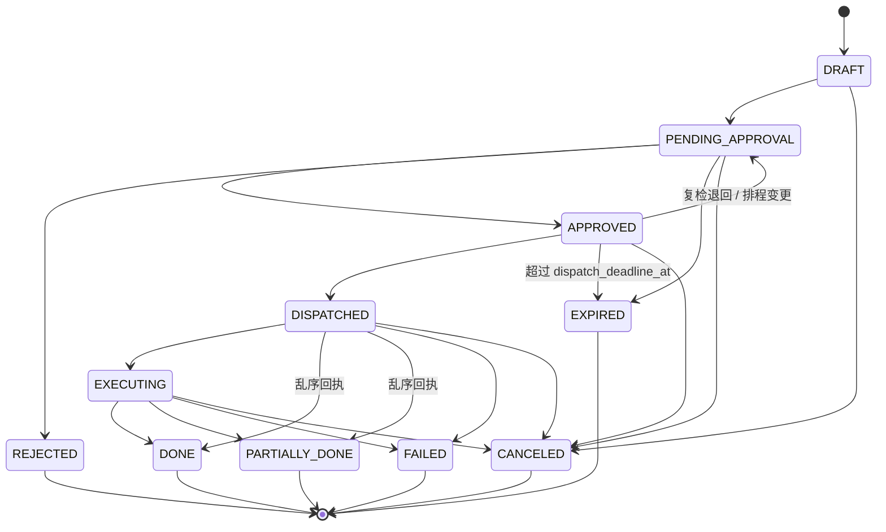

# 核心契约（P0 L1 冻结）

本文件与 `contracts/*.schema.json`、`internal/model` 一起构成 L1 冻结的契约。各阶段只引用、不修改。

## 冻结规则

- 冻结后任何变更（字段、枚举、状态、迁移边）都要升版本号，并经契约 Owner 书面批准后再合入。
- 只做向后兼容的增量：新增可选字段或新增枚举值时升 minor；删除、改名、改语义时升 major，并同时提供迁移说明。
- `internal/model` 是 Go 侧唯一实现，只能 import 标准库（archtest 守卫）。`contracts/*.schema.json` 与 `internal/model` 的一致性由 `internal/model` 下的 schema 测试校验。
- 表结构以 `migrations/0001_init.up.sql` 为准。改表只能新增迁移文件，禁止 AutoMigrate，也不能改已发布的迁移。

## 契约清单

| 契约 | Schema | Go 类型 |
|------|--------|---------|
| 建议卡 | `contracts/advice_card.schema.json` | `model.AdviceCard` |
| 引用 | `contracts/citation.schema.json` | `model.Citation` |
| 作业单 | `contracts/work_order.schema.json` | `model.WorkOrder` |
| 审批单 | `contracts/approval_ticket.schema.json` | `model.ApprovalTicket` |
| 运行状态 | `contracts/run_state.schema.json` | `model.RunState` |

## 作业单状态机

## 迁移表

与 `model.WorkOrderTransitions` 逐条一致。不在表中作为 from 出现的状态都是终态。

| from | 允许的 to |
|------|-----------|
| DRAFT | PENDING_APPROVAL, CANCELED |
| PENDING_APPROVAL | APPROVED, REJECTED, EXPIRED, CANCELED |
| APPROVED | DISPATCHED, PENDING_APPROVAL, EXPIRED, CANCELED |
| DISPATCHED | EXECUTING, DONE, PARTIALLY_DONE, FAILED, CANCELED |
| EXECUTING | DONE, PARTIALLY_DONE, FAILED, CANCELED |
| DONE / PARTIALLY_DONE / REJECTED / EXPIRED / FAILED / CANCELED | 终态，无出边 |

## 迁移执行（service.WorkOrderService.Transition）

在调用方事务（`*repository.DB`，即 `*gorm.DB`）内依次执行以下步骤，任一步失败则整个事务回滚：

1. `GetState` 读取 status、row_ver、run_id，查询带 tenant_id 和 farm_id 条件。
2. `model.CanTransition(from, to)` 判断迁移是否合法，非法返回 `model.ErrIllegalTransition`。
3. 执行乐观锁 `UPDATE work_order SET status=?, row_ver=row_ver+1, updated_at=? WHERE id=? AND tenant_id=? AND farm_id=? AND status=? AND row_ver=?`。影响 0 行时返回 `model.ErrConcurrentUpdate`。
4. 追加一行 `work_order_transition`。
5. 调用 `EventStore.AppendTx` 写入 `ORDER_TRANSITION` 事件。seq 由同一连接上的 `LAST_INSERT_ID(event_seq + 1)` 分配。

本方法不加 Redis 锁。`lock:order:{order_id}` 由需要串行化外部副作用的调用方（如 L8 下发）持有。

## 开票前约束拦截留痕（P1-L3，偏离 §6.4）

§6.4 原文要求 `constraint_check` 用 INSERT IGNORE、历次校验都可见。实现为了不加迁移，做了如下偏离：

- **PRE_APPROVAL 行为最近一次复核结果，历次拦截证据见 CONSTRAINT_BLOCKED payload。** `constraint_check(order, PRE_APPROVAL, attempt=ticket_seq)` 按 uk_check upsert，并删掉本次未出现的 rule_id。
- `CONSTRAINT_BLOCKED`（run_event，只追加；审计投影 APPROVAL / FAILED，target `order:{order_id}`）的 payload 为 `model.ConstraintBlockedPayload`：
  - `order_id`、`rule_ids`（未通过的 rule_id，按校验顺序）；
  - `checks[]`：每条未通过行的 `rule_id`、`observed`、`threshold`（原样取自校验行，`threshold.kb` 为 `kb:<kb_id>@<version>`）、`note`（即 `observed.note`）；通过行不写入；
  - `truncated`：payload 上限 8KB（8192 字节）。超出时先从 `checks` 末尾逐行截掉，仍超再截 `rule_ids` 末尾，并置 `truncated: true`；未截断时不出现该字段。
- 开票与拦截事务的第一条语句都是 `SELECT id FROM work_order WHERE tenant_id=? AND farm_id=? AND id=? FOR UPDATE`，同一张单的写入串行。拦截输给并发开票时回滚本次校验行与事件，在事务外记一条 Warn 日志（order_id、run_id、rule_ids、ticket_id）。

## 分层规则（internal/archtest，随 make test 执行）

- agent 不得 import controller、service。agent/harness 不得 import graph、knowledge、calc、guardrail、service、controller、repository。
- 生产代码（除 internal/evalkit 与 cmd/eval 外）不得 import evalkit。
- model 只能 import 标准库。controller 在模块内只能 import service 和 model。
- gorm 只允许 repository、app、cmd import。viper 只允许 config import。gin 只允许 controller import。
- `time.Now` 只允许出现在 `internal/clock/system.go`，其他代码一律通过注入的 `clock.Clock` 取时间。
- 设备 Adapter（internal/adapter）只允许下发器 `internal/service/workorder_dispatch.go` import；app、cmd 装配与 evalkit 注入 RecordingAdapter 除外（L8）。
- `repository.NewSystemScope`（跨农场扫描凭证）只允许 `internal/service/scan.go`、`internal/service/outbox.go` 调用；P1-L4 扫描迁到 `cmd/worker` 后白名单收紧为只含 `cmd/worker`（P1-L1-B）。
- 设备 Adapter（internal/adapter 及子包）不得 import repository、agent：Adapter 只翻译协议，原始指令 / 回执经 `Traced` 注入的 `RawPutter` / `CallRecorder` 接口落库，下发台账由下发器写（P1-L2）。
- `internal/agent/guardrail/constraint`（约束校验器）不得 import repository、service、agent/tools、adapter，也不得 import `os`、`net`、`database/sql`、`io/fs`：校验器只读入参观测，取数由 graph / service 完成（P1-L3）。
