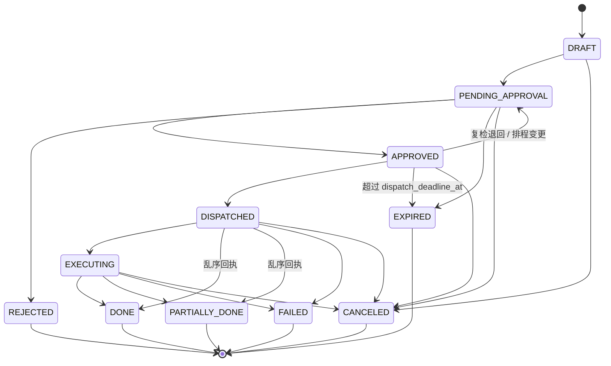

# 核心契约（P0 L1 冻结）

本文件与 `contracts/*.schema.json`、`internal/model` 一起构成 L1 冻结的契约。各阶段只引用、不修改。

## 冻结规则

- 冻结后任何变更（字段、枚举、状态、迁移边）都要升版本号，并经契约 Owner 书面批准后再合入。
- 只做向后兼容的增量：新增可选字段或新增枚举值时升 minor；删除、改名、改语义时升 major，并同时提供迁移说明。
- `internal/model` 是 Go 侧唯一实现，只能 import 标准库（archtest 守卫）。`contracts/*.schema.json` 与 `internal/model` 的一致性由 `internal/model` 下的 schema 测试校验。
- 表结构以 `migrations/0001_init.up.sql` 为准。改表只能新增迁移文件，禁止 AutoMigrate，也不能改已发布的迁移。

## 契约清单

| 契约 | Schema | Go 类型 |
|------|--------|---------|
| 建议卡 | `contracts/advice_card.schema.json` | `model.AdviceCard` |
| 引用 | `contracts/citation.schema.json` | `model.Citation` |
| 作业单 | `contracts/work_order.schema.json` | `model.WorkOrder` |
| 审批单 | `contracts/approval_ticket.schema.json` | `model.ApprovalTicket` |
| 运行状态 | `contracts/run_state.schema.json` | `model.RunState` |

## 作业单状态机

## 迁移表

与 `model.WorkOrderTransitions` 逐条一致。不在表中作为 from 出现的状态都是终态。

| from | 允许的 to |
|------|-----------|
| DRAFT | PENDING_APPROVAL, CANCELED |
| PENDING_APPROVAL | APPROVED, REJECTED, EXPIRED, CANCELED |
| APPROVED | DISPATCHED, PENDING_APPROVAL, EXPIRED, CANCELED |
| DISPATCHED | EXECUTING, DONE, PARTIALLY_DONE, FAILED, CANCELED |
| EXECUTING | DONE, PARTIALLY_DONE, FAILED, CANCELED |
| DONE / PARTIALLY_DONE / REJECTED / EXPIRED / FAILED / CANCELED | 终态，无出边 |

## 迁移执行（service.WorkOrderService.Transition）

在调用方事务（`*repository.DB`，即 `*gorm.DB`）内依次执行以下步骤，任一步失败则整个事务回滚：

1. `GetState` 读取 status、row_ver、run_id，查询带 tenant_id 和 farm_id 条件。
2. `model.CanTransition(from, to)` 判断迁移是否合法，非法返回 `model.ErrIllegalTransition`。
3. 执行乐观锁 `UPDATE work_order SET status=?, row_ver=row_ver+1, updated_at=? WHERE id=? AND tenant_id=? AND farm_id=? AND status=? AND row_ver=?`。影响 0 行时返回 `model.ErrConcurrentUpdate`。
4. 追加一行 `work_order_transition`。
5. 调用 `EventStore.AppendTx` 写入 `ORDER_TRANSITION` 事件。seq 由同一连接上的 `LAST_INSERT_ID(event_seq + 1)` 分配。

本方法不加 Redis 锁。`lock:order:{order_id}` 由需要串行化外部副作用的调用方（如 L8 下发）持有。

## 分层规则（internal/archtest，随 make test 执行）

- agent 不得 import controller、service。agent/harness 不得 import graph、knowledge、calc、guardrail、service、controller、repository。
- 生产代码（除 internal/evalkit 与 cmd/eval 外）不得 import evalkit。
- model 只能 import 标准库。controller 在模块内只能 import service 和 model。
- gorm 只允许 repository、app、cmd import。viper 只允许 config import。gin 只允许 controller import。
- `time.Now` 只允许出现在 `internal/clock/system.go`，其他代码一律通过注入的 `clock.Clock` 取时间。
